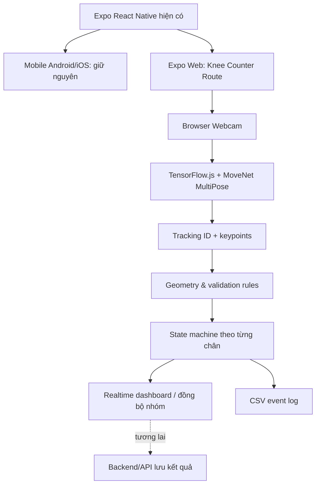
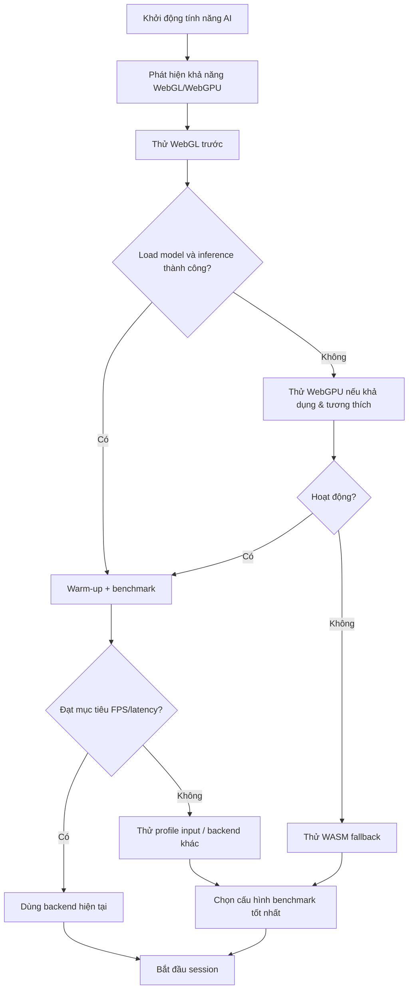
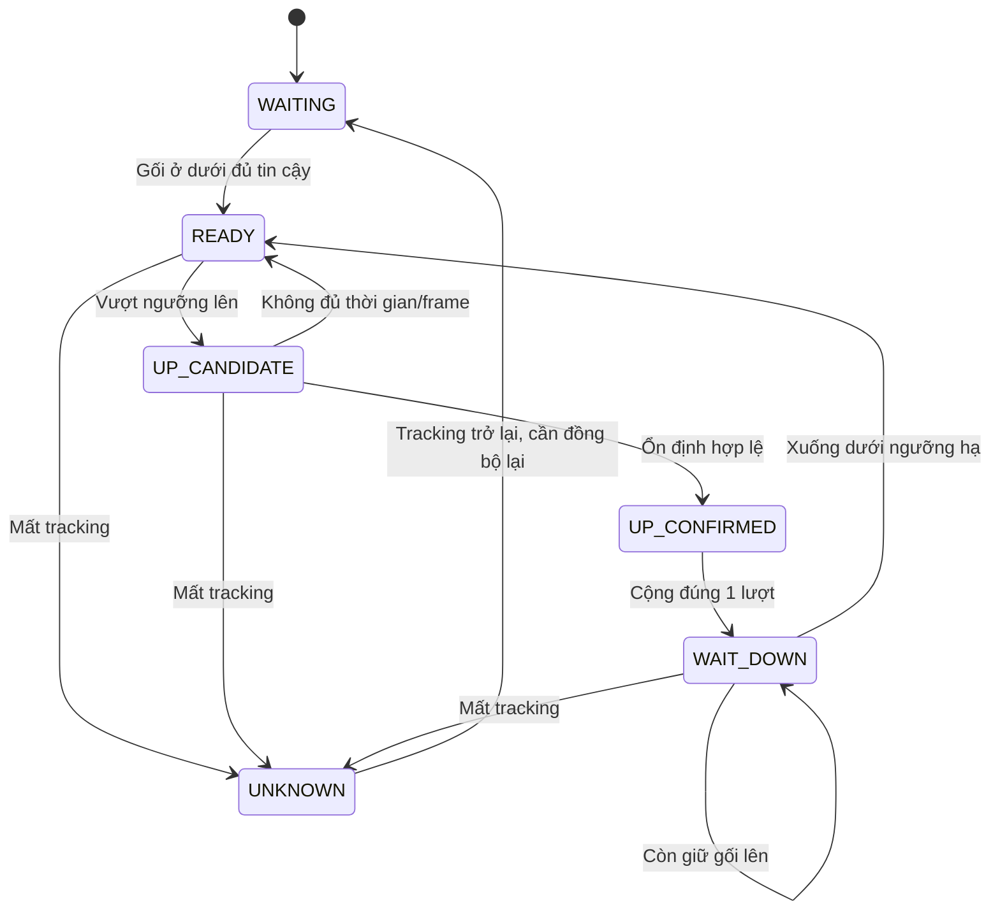
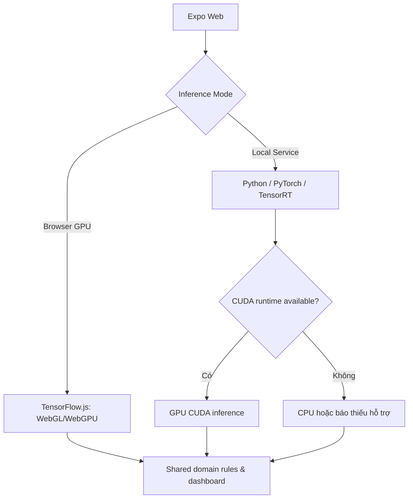

# KẾ HOẠCH TRIỂN KHAI AI REAL-TIME MULTI-PERSON KNEE DETECTION & COUNTER

> **Nền tảng:** Expo React Native Web (trong cùng repository mobile hiện tại)  
> **Model đề xuất:** MoveNet MultiPose Lightning  
> **Inference:** TensorFlow.js (WebGL ưu tiên, thử WebGPU, fallback WASM)  
> **Thiết bị:** Laptop + Webcam  
> **Quy mô:** 2–6 người đồng thời  
> **Trạng thái tài liệu:** Kế hoạch kỹ thuật và tiêu chí nghiệm thu; **chưa phải kết quả benchmark thực tế**.  
> **Ngày lập:** 18/10/2026

---

## I. MỤC TIÊU VÀ PHẠM VI

### 1. Mục tiêu

Mở rộng **ứng dụng React Native + Expo đang có** để hỗ trợ Web trên trình duyệt laptop, tận dụng webcam nhằm:

1. Phát hiện đồng thời **2–6 học viên Taekwondo**.
2. Xác định các keypoint vai, hông, đầu gối và cổ chân của mỗi người.
3. Kiểm tra đầu gối đã nâng ngang hoặc vượt qua hông theo **ngưỡng điều chỉnh ±%**.
4. Theo dõi trạng thái và **đếm lượt rút gối riêng cho từng người, từng chân** mà không đếm trùng theo từng frame.
5. Có chế độ thống kê số người đạt trong cùng frame và đánh giá **đồng bộ nhóm** trong một cửa sổ thời gian.
6. Tận dụng GPU laptop qua WebGL/WebGPU khi có thể, có fallback CPU/WASM, thu thập benchmark và các thông số chẩn đoán.
7. Giữ nguyên các tính năng Android/iOS, không tách thành một dự án Vite hoặc React Web mới.

### 2. Phạm vi của MVP

**Bao gồm:** Expo Web, webcam browser, MoveNet MultiPose, GPU capability diagnostics, chọn backend inference, xử lý keypoint, tracking, thuật toán ngưỡng, state machine đếm lượt, dashboard và xuất CSV.

**Chưa yêu cầu:** model training/fine-tuning, nhận diện danh tính khuôn mặt, gửi video lên server, hỗ trợ máy có CUDA native qua một tiến trình Python, hoặc chấm điểm động tác võ mang tính quyết định chính thức khi chưa nghiệm thu sai số.

### 3. Quyết định công nghệ

| Thành phần | Công nghệ | Quyết định |
|---|---|---|
| Repository | Dự án Expo React Native hiện có | Giữ nguyên |
| Web | Expo Web + React Native for Web | Chọn |
| Navigation | Expo Router hoặc React Navigation hiện tại | Giữ cách đang dùng |
| Camera Web | `navigator.mediaDevices.getUserMedia()` | Chọn |
| Frame loop | `requestVideoFrameCallback()` (fallback `requestAnimationFrame()`) | Chọn |
| Pose model | **MoveNet MultiPose Lightning** | Mặc định |
| Pose SDK | `@tensorflow-models/pose-detection` | Chọn |
| Runtime | TensorFlow.js | Chọn |
| Backend | `webgl` → đối chứng `webgpu` → fallback `wasm` | Cấu hình theo khả năng và benchmark |
| Tracking | MoveNet `enableTracking`, tracker BoundingBox | Chọn, phải kiểm chứng ID |
| Pose overlay | HTML Canvas/Web DOM riêng cho Web | Chọn |
| Counting | TypeScript pure rules + state machine | Chọn |
| Local/server inference | Không yêu cầu cho MVP | Hoãn |
| Vite app riêng / WebView / `use dom` | Không dùng | Loại trừ |
| `tfjs-react-native` | Không cần cho pipeline Web | Loại trừ |

### 4. Kiến trúc tổng thể



**Nguyên tắc:** Một camera → một inference engine → tracking → rule engine → đếm lượt → UI. Không tự động đẩy video tới backend.

---

## II. GPU, CUDA VÀ CHÍNH SÁCH TỰ CHỌN BACKEND

### 1. Phân biệt GPU, WebGL/WebGPU và CUDA

- **GPU** là bộ xử lý đồ họa, có thể là Intel/AMD/NVIDIA, tích hợp hoặc rời.
- **WebGL** là API đồ họa của trình duyệt, có thể dùng GPU để tính toán TensorFlow.js.
- **WebGPU** là API compute/đồ họa hiện đại; hỗ trợ và tốc độ tùy trình duyệt, driver, model và operator.
- **CUDA** là nền tảng tính toán NVIDIA. JavaScript chạy trong một trang Web thông thường **không thể truy cập CUDA trực tiếp hoặc xác minh đáng tin cậy CUDA runtime**.
- Máy có NVIDIA RTX không đồng nghĩa Web sẽ chạy backend CUDA. Chrome/Edge có thể dùng GPU NVIDIA **thông qua WebGL/WebGPU** nếu trình duyệt và hệ điều hành chọn GPU đó.
- Không được tuyên bố “CUDA Available” chỉ vì WebGL renderer có chữ `NVIDIA`.

### 2. GPU capability diagnostics

Tạo `detectComputeCapabilities()` trả các trường:

```typescript
type ComputeCapabilities = {
  webglSupported: boolean;
  webgpuSupported: boolean;
  webgpuAdapterAvailable: boolean;
  gpuVendor: string | null;
  gpuRenderer: string | null;
  cudaStatus: "NOT_DETECTABLE_IN_BROWSER";
  hardwareAccelerationVerified: boolean | null;
  selectedBackend: "webgl" | "webgpu" | "wasm" | null;
  inferenceFps: number | null;
  p50LatencyMs: number | null;
  p95LatencyMs: number | null;
  modelInputSize: number | null;
};
```

`hardwareAccelerationVerified = true` chỉ khi có đủ bằng chứng xác nhận; nếu không chắc chắn trả `null`.

**Phát hiện WebGL (Web-only):**

```typescript
function detectWebGL() {
  const canvas = document.createElement("canvas");
  const gl =
    canvas.getContext("webgl2", { failIfMajorPerformanceCaveat: true }) ??
    canvas.getContext("webgl", { failIfMajorPerformanceCaveat: true });

  if (!gl) return { supported: false, renderer: null };

  const ext = gl.getExtension("WEBGL_debug_renderer_info");
  const renderer = ext
    ? String(gl.getParameter(ext.UNMASKED_RENDERER_WEBGL))
    : null;

  return { supported: true, renderer };
}
```

API debug renderer có thể bị trình duyệt giới hạn vì quyền riêng tư. Không đọc được tên card không có nghĩa là không có GPU.

**Phát hiện WebGPU:** kiểm tra `navigator.gpu`, sau đó `await navigator.gpu.requestAdapter({ powerPreference: 'high-performance' })` nếu API được hỗ trợ; xử lý trường hợp không có adapter hoặc bị từ chối. `powerPreference` chỉ là gợi ý.

**Hướng dẫn kiểm tra thủ công trên Windows:**

1. Mở `chrome://gpu` xem khả năng tăng tốc WebGL.
2. Kiểm tra Chrome Settings → System → Graphics acceleration.
3. Trong Windows Settings → System → Display → Graphics, có thể đặt Chrome vào chế độ `High performance` nhằm ưu tiên GPU rời.
4. Ghi nhận backend thực tế bằng `tf.getBackend()`; đo inference latency thay vì suy đoán từ tên GPU.

### 3. Chính sách tự chọn backend



**Quy tắc:**

1. Ưu tiên WebGL vì là con đường chủ đạo đã được dùng rộng rãi cho MoveNet TF.js.
2. WebGPU chỉ là ứng viên thử nghiệm đối chứng, **không mặc định nhanh hơn**.
3. WASM là fallback CPU có thể dùng nếu load đầy đủ backend và assets tương ứng.
4. Không chọn backend dựa duy nhất vào GPU name, vendor hoặc có/không CUDA.
5. Khởi tạo model trên backend cần benchmark thật; đo với cùng nguồn frame, sau warm-up.
6. Khi đổi backend: dừng frame loop → chờ inference kết thúc → dispose detector/tensor → khởi tạo backend/model mới. Giữ counters đã xác nhận, khôi phục tracking có kiểm soát; không cộng lượt ảo.
7. Nếu backend không khởi tạo được, hiển thị lỗi/fallback có giải thích, không crash ứng dụng.

---

## III. CẤU TRÚC SOURCE CODE MỤC TIÊU

> Đây là cấu trúc **đề xuất**, cần điều chỉnh theo layout thực tế. Nếu dự án dùng React Navigation thì gắn feature vào navigator hiện tại thay vì bắt buộc tạo thư mục `app/`.

```text
taekwondo-mobile-react-native/
├── app/                           # nếu đã sử dụng Expo Router
│   └── knee-counter/
│       ├── index.tsx              # fallback native
│       └── index.web.tsx          # route web
├── src/
│   └── features/
│       └── knee-counter/
│           ├── components/
│           │   ├── KneeCounterScreen.web.tsx
│           │   ├── CameraView.web.tsx
│           │   ├── PoseOverlay.web.tsx
│           │   ├── ParticipantPanel.tsx
│           │   ├── ThresholdControl.tsx
│           │   └── PerformancePanel.web.tsx
│           ├── ai/
│           │   ├── gpuCapabilities.web.ts
│           │   ├── backendSelector.web.ts
│           │   ├── moveNetDetector.web.ts
│           │   ├── inferenceLoop.web.ts
│           │   └── benchmark.web.ts
│           ├── tracking/
│           │   ├── participantTracker.ts
│           │   └── zoneAssignment.ts
│           ├── domain/
│           │   ├── keypoints.ts
│           │   ├── kneeGeometry.ts
│           │   ├── motionStateMachine.ts
│           │   ├── countingRules.ts
│           │   └── groupEvaluator.ts
│           ├── hooks/
│           │   ├── useCamera.web.ts
│           │   └── useKneeCounter.web.ts
│           ├── config/
│           │   └── kneeCounterConfig.ts
│           ├── types/
│           │   └── kneeCounter.types.ts
│           └── tests/
│               ├── kneeGeometry.test.ts
│               ├── motionStateMachine.test.ts
│               ├── tracking.test.ts
│               └── groupEvaluator.test.ts
├── public/
│   └── models/                    # tùy chọn self-host model
└── package.json
```

**Ranh giới module:**

- `ai/`: chạy model, GPU/backend, inference, đo hiệu năng.
- `tracking/`: liên kết tracking ID với participant ID, vùng đứng.
- `domain/`: hàm TypeScript thuần, độc lập với React/DOM/model.
- `components/`: UI và overlay.
- `hooks/`: lifecycle webcam, detector, screen/session.
- `config/`: thông số tập trung, có validate các giá trị user chỉnh.
- **Không import browser-only code vào entry point native**; không truy cập `window`/`document` ở module dùng chung.

---

## IV. 9 GIAI ĐOẠN TRIỂN KHAI

### Giai đoạn 01 — Audit dự án Expo và regression baseline

**Mục tiêu:** kiểm tra môi trường trước khi sửa; bảo vệ mobile.

**Công việc:**

1. Kiểm tra `package.json`, `app.json` / `app.config.ts`, `metro.config.js`, `babel.config.js`, `tsconfig.json`.
2. Xác định SDK Expo, React, React Native, Expo Router hay React Navigation; xác minh Android/iOS đang hoạt động ở mức nào.
3. Xác định những module native chưa hỗ trợ Web; lập danh sách cần cô lập.
4. Tạo nhánh `feature/web-knee-counter`.
5. Kiểm tra chạy thử Web và Native trước khi thêm AI, ghi nhận lỗi baseline.
6. Không nâng cấp toàn SDK chỉ để làm tính năng này nếu chưa có lý do tương thích cụ thể.

**Lệnh tham khảo (PowerShell):**

```powershell
npx expo-doctor
npx expo config --type public
npm ls expo react react-native expo-router react-native-web
npx tsc --noEmit
```

**Đầu ra / Gate:** Báo cáo phiên bản và baseline; chiến lược rollback; xác nhận nơi gắn route.

### Giai đoạn 02 — Kích hoạt và cô lập Expo Web

**Mục tiêu:** một repository chạy được `/knee-counter` trên Web.

**Cài đặt:**

```powershell
npx expo install react-dom react-native-web @expo/metro-runtime
```

**Ví dụ config nếu chưa dùng Metro cho Web:**

```json
{
  "expo": {
    "web": { "bundler": "metro" }
  }
}
```

**Lệnh chạy:**

```powershell
npx expo start --web
```

**Quy tắc:**

- Route `/knee-counter` dùng màn hình Web `.web.tsx` và file fallback cross-platform tương ứng nếu Expo Router yêu cầu.
- Native giữ nguyên chức năng; màn hình mới có thể chỉ hiển thị thông báo không hỗ trợ trên Mobile.
- DOM API được gọi trong lifecycle Web client; không thực thi tại module scope hoặc trong SSR.
- Native entry point không bundle các dependency TensorFlow.js chỉ phục vụ Web.

**Gate:** Web mở route; Android/iOS không bị ảnh hưởng; bundling kiểm thử hợp lệ.

### Giai đoạn 03 — Camera Engine

**Mục tiêu:** webcam hoạt động, quản lý stream/lifecycle ổn định.

**Luồng:** Click Bật camera → xin quyền → gắn stream vào `<video>` → đợi metadata/play → chạy inference → dừng và cleanup.

**Mẫu:**

```typescript
const stream = await navigator.mediaDevices.getUserMedia({
  audio: false,
  video: {
    width: { ideal: 1280 },
    height: { ideal: 720 },
    frameRate: { ideal: 30, max: 30 },
    facingMode: "user"
  }
});

video.srcObject = stream;
video.playsInline = true;
await video.play();
```

**Trường hợp lỗi bắt buộc:**

| Tình huống | Phản ứng |
|---|---|
| Không có webcam | Báo lỗi rõ ràng |
| Từ chối permission | Hướng dẫn cấp quyền |
| Camera đang bị chiếm | Retry và chọn camera khác nếu có |
| Rút camera | Dừng inference, không đếm |
| Tab ẩn / rời màn hình | Pause xử lý |
| Stop session | Hủy callback, đóng media tracks |
| Component unmount | `dispose` tài nguyên |
| Quay lại | Khởi tạo lại, không dùng stream cũ đã stop |

**Bảo mật:** Trình duyệt yêu cầu secure context: HTTPS trên production; localhost thường được hỗ trợ cho phát triển.

**Gate:** video hoạt động ít nhất 15 phút; bật/tắt nhiều lần không khóa camera hay leak stream.

### Giai đoạn 04 — GPU Discovery & Backend Selector

**Mục tiêu:** tự chọn khả năng chạy inference tốt nhất không phụ thuộc CUDA.

**Công việc:**

1. Cài/đăng ký backend tương ứng.
2. Phát hiện WebGL context, WebGPU adapter (nếu API tồn tại), ghi thông tin GPU ở mức trình duyệt cho phép.
3. Khởi tạo TensorFlow.js WebGL, load model; nếu thất bại thử WebGPU nếu tương thích; nếu không fallback WASM.
4. Warm-up và benchmark với nguồn frame giống nhau.
5. Có lựa chọn **Auto / WebGL / WebGPU / WASM** trong diagnostics; tùy chọn không hợp lệ được disable và giải thích lý do.
6. Xây cơ chế đổi backend an toàn: dừng/khởi tạo lại detector, không reset counters tùy tiện.
7. Log: backend, input dimension, inference FPS, P50/P95 latency, khả năng WebGL/WebGPU.

**Gate:** thử được đường chạy GPU và fallback; không crash nếu WebGPU hoặc CUDA không tồn tại.

### Giai đoạn 05 — MoveNet MultiPose, inference loop và tracking

**Cài dependencies Web (khóa bản sau khi xác minh tương thích Metro/Expo):**

```powershell
npm install @tensorflow-models/pose-detection `
  @tensorflow/tfjs-core `
  @tensorflow/tfjs-converter `
  @tensorflow/tfjs-backend-webgl `
  @tensorflow/tfjs-backend-webgpu `
  @tensorflow/tfjs-backend-wasm
```

**Khởi tạo MoveNet (mẫu API cần xác minh theo phiên bản đã khóa):**

```typescript
const detector = await poseDetection.createDetector(
  poseDetection.SupportedModels.MoveNet,
  {
    modelType: poseDetection.movenet.modelType.MULTIPOSE_LIGHTNING,
    enableTracking: true,
    enableSmoothing: true,
    trackerType: poseDetection.TrackerType.BoundingBox,
    multiPoseMaxDimension: 320,
    minPoseScore: 0.25
  }
);
```

`multiPoseMaxDimension` nên thử **256, 320, 384, 448** (bội số 32), không mặc định kích thước lớn là chính xác hoặc nhanh hơn. Model có giới hạn tối đa **6 người**.

**Output adapter (độc lập model):**

```typescript
type PersonPose = {
  trackId: number | null;
  detectedAtMs: number;
  poseScore: number;
  keypoints: Keypoint[];
  boundingBox: BoundingBox | null;
};
```

**Frame loop:**

```text
Camera frame ready
   ↓
Inference đang chạy?
  ├─ Có: bỏ qua frame
  └─ Không: estimatePoses(video)
                 ↓
       Validate + normalize
                 ↓
            Tracking
                 ↓
       Geometry + counting
                 ↓
        Canvas + dashboard
                 ↓
         Frame tiếp theo
```

- Ưu tiên `requestVideoFrameCallback`; fallback `requestAnimationFrame` nếu cần.
- Không chạy 2 inference song song trên một detector; không queue frame tồn đọng.
- Không `setState()` React cho từng keypoint trên mọi frame.
- Model/dispose phải được quản lý khi đổi backend, ngắt camera và unmount.

**Gate:** phát hiện 2–6 người, overlay keypoints đúng tọa độ, có đo FPS/latency, cleanup chuẩn.

### Giai đoạn 06 — Thuật toán kiểm tra gối & đếm lượt

**Mục tiêu:** AI trả keypoints; domain engine đánh giá PASS/FAIL/UNKNOWN và phát sự kiện cộng lượt.

#### 6.1. Map keypoints MoveNet (COCO 17)

| Bộ phận | Trái | Phải |
|---|---:|---:|
| Vai | 5 | 6 |
| Hông | 11 | 12 |
| Gối | 13 | 14 |
| Cổ chân | 15 | 16 |

**Validation bắt buộc:**

- Pose và ID có đủ độ tin cậy; vai/hông/gối cần confidence tối thiểu thử nghiệm 0.60.
- Muốn đánh giá góc gối thì phải kiểm tra thêm cổ chân.
- Tọa độ là finite numbers, vai–hông có khoảng cách đủ lớn; không chia cho 0.
- `UNKNOWN` nếu thiếu keypoint, mất tracking, occlusion hoặc dữ liệu lỗi; **không** xem `UNKNOWN` là FAIL.

#### 6.2. Knee Height Calculation

Với mỗi chân, gọi:

- `S=(x_s,y_s)` vai
- `H=(x_h,y_h)` hông
- `K=(x_k,y_k)` gối

Trong ảnh 2D, trục Y tăng từ trên xuống dưới:

\[
\mathrm{torsoHeight} = |y_h-y_s|
\]

\[
R = \frac{y_h-y_k}{\mathrm{torsoHeight}}
\]

\[
\mathrm{PASS}\iff R\geq\frac{T}{100}
\]

`T` là ngưỡng điều chỉnh (ví dụ -10%, 0%, +10%). `R=0` nghĩa gối ngang hông; `R>0` gối cao hơn hông. **Phương pháp 2D không đo được chiều cao thực trong không gian 3D**, cần góc camera cố định và thử nghiệm đối chiếu.

**Bảng ví dụ:**

| T | Điều kiện PASS |
|---|---|
| -10% | `R >= -0.10` |
| 0% | `R >= 0` |
| +10% | `R >= +0.10` |
| +20% | `R >= +0.20` |

**Code domain rule (tham khảo):**

```typescript
type Point = { x: number; y: number; score: number };

function checkKneeHeight(
  shoulder: Point,
  hip: Point,
  knee: Point,
  thresholdPercent = 0,
  minScore = 0.6
): "PASS" | "FAIL" | "UNKNOWN" {
  if ([shoulder, hip, knee].some(p =>
    !Number.isFinite(p.x) || !Number.isFinite(p.y) || p.score < minScore
  )) return "UNKNOWN";

  const torsoHeight = Math.abs(hip.y - shoulder.y);
  if (torsoHeight < 1e-6) return "UNKNOWN";

  const ratio = (hip.y - knee.y) / torsoHeight;
  return ratio >= thresholdPercent / 100 ? "PASS" : "FAIL";
}
```

#### 6.3. Anti-jitter, hysteresis, stability

Sử dụng 2 ngưỡng:

\[
T_{up} = T/100,\qquad T_{down} = T_{up} - 0.10
\]

| Ngưỡng giao diện | Lên (>=) | Xuống (<=) |
|---|---:|---:|
| -10% | -10% | -20% |
| 0% | 0% | -10% |
| +10% | +10% | 0% |
| +20% | +20% | +10% |

**Giá trị thử nghiệm (cần benchmark):**

| Rule | Giá trị khởi tạo |
|---|---:|
| `minKeypointScore` | 0.60 |
| `minStableFrames` | 2 |
| `minHoldMs` | 50 ms |
| `hysteresisRatio` | 0.10 |
| `minRepIntervalMs` | 150 ms |
| `lostTrackGraceMs` | 500 ms |
| `trackingExpiryMs` | 1,000 ms |
| `thresholdPercent` | 0 |

Không cứng hóa các thông số trên thành quy chuẩn võ thuật; điều chỉnh bằng dữ liệu thực tế.

#### 6.4. State machine từng người, từng chân



**Counting rules:**

1. Phải có trạng thái `READY` quan sát trước đó.
2. Chỉ cộng khi đi qua `UP_CANDIDATE → UP_CONFIRMED` và đạt điều kiện thời gian/frame.
3. Giữ gối trên hông nhiều frame chỉ tính 1 lượt.
4. Chỉ cho phép lượt mới khi hạ xuống dưới ngưỡng `T_down`.
5. Mất keypoint/ID thì không cộng, không tự suy diễn.
6. Khôi phục ID không chắc chắn → cần tái xác nhận trạng thái xuống.
7. Đổi ngưỡng khi đang chạy **không được cộng lượt giả**: hủy candidate/reset bộ phát hiện cạnh thích hợp, giữ counter đã xác nhận.
8. Logic trái/phải độc lập.
9. Timestamp thống nhất từ cùng một clock (ví dụ `performance.now()`) trong phiên.

#### 6.5. Optional rules cho kỹ thuật Taekwondo

| Rule | Mục đích | MVP |
|---|---|---|
| Knee Height | Gối vượt ngưỡng hông | Bắt buộc |
| Knee Flexion Angle | Có gập gối | Mặc định tắt |
| Torso Orientation | Hạn chế cúi người gian lận | Mặc định tắt |
| Tracking Stability | Hạn chế sai ID | Bắt buộc |
| Minimum Hold | Chống nhiễu | Bắt buộc, chỉnh được |

Góc gập gối tính qua hông `H`, gối `K`, cổ chân `A`:

\[
\theta=\cos^{-1}\left(\frac{(H-K)\cdot(A-K)}{\|H-K\|\,\|A-K\|}\right)
\]

**Không hardcode một góc chuẩn** nếu chưa thống nhất với HLV cho loại động tác cụ thể.

**Gate:** Unit tests đầy đủ cho PASS/FAIL/UNKNOWN, state machine, 2 chân, giữ gối, rung ngưỡng, mất tracking, đổi threshold và khôi phục.

### Giai đoạn 07 — Multi-person tracking, gán học viên và dashboard

#### 7.1. Hai lớp ID

| ID | Ví dụ | Vai trò |
|---|---|---|
| `trackId` | `12` | ID tạm thời của tracker MoveNet |
| `participantId` | `HV03` | ID ổn định trong phiên kiểm tra |

- Bật tracking trong MoveNet nhưng không xem trackId là mã học viên bền vững.
- Với 2–6 người, ưu tiên đứng theo **vùng được chỉ định từ trái sang phải**; gán participant ID cho từng vùng.
- Khi mất dấu, có thể tái liên kết với lịch sử vị trí/chuyển động nếu đủ tin cậy. Khi mơ hồ (hai người giao nhau), tạm dừng cộng lượt cho đối tượng liên quan và yêu cầu xác nhận nếu cần.
- **Không dùng `poses[0]`, `poses[1]` làm danh tính người**.

#### 7.2. Ba chế độ

1. **Individual Repetitions** — Đếm lượt từng người, chân trái/chân phải.
2. **Current Group Pass** — Đếm số người đủ điều kiện ở **cùng frame**.
3. **Synchronized Group** — Xác định các học viên được chọn hoàn thành động tác trong cùng cửa sổ thời gian (mặc định thử 300 ms), không chỉ so tổng lượt.

#### 7.3. UI Dashboard

Thành phần:

- Video camera chiếm diện tích chính, Canvas skeleton và mã người.
- Thanh tóm tắt: số người phát hiện / số người đạt / tổng lượt.
- Danh sách 2–6 người: participant ID, track ID, trạng thái PASS/FAIL/UNKNOWN, lượt trái, lượt phải.
- Slider điều chỉnh `thresholdPercent` từ -30% đến +30%, bước 5%.
- Chế độ: cá nhân / nhóm hiện tại / đồng bộ.
- Controls: Start, Pause, Resume, Stop, Reset, Export CSV.
- Diagnostics collapsible: backend (`webgl`, `webgpu`, `wasm`), FPS, inference latency, input size, confidence.

**Rendering rules:**

- Skeleton vẽ Canvas, không dùng hàng loạt React components per keypoint/per frame.
- Canvas khớp video qua resize/contain/cover và thiết kế tọa độ đúng.
- Mirror chỉ ảnh hưởng hiển thị, không đảo logic chân trái/phải.
- PASS/FAIL/UNKNOWN cần hiển thị riêng.
- Dashboard state cập nhật khoảng 4–10 Hz, không cần 30 React renders/s.
- Khi đổi backend/camera không tự reset counter; Reset phải là thao tác tường minh.

**Gate:** Người chấm theo dõi được từng participant, lượt và trạng thái đúng, không hoán đổi counters giữa người đứng cố định.

### Giai đoạn 08 — Benchmark, tests và tối ưu

#### 8.1. Các metric bắt buộc

| Metric | Định nghĩa |
|---|---|
| Camera FPS | Frame rate video camera thực tế |
| Inference FPS | Số frame được model xử lý/giây |
| Average latency | Thời gian inference trung bình |
| P50/P95 latency | Phân vị độ trễ inference |
| End-to-end latency | Từ frame video đến hiển thị kết quả |
| Active backend | Backend chạy thật |
| Input dimension | Kích thước model input |
| Memory trend | Theo dõi tăng bộ nhớ bất thường |
| Detection completeness | Tỷ lệ frame nhìn thấy đủ số người |
| ID switches | Số lần tracker đổi/nhầm ID |

#### 8.2. Quy trình benchmark

1. Chọn **cùng một video thực tế** cho phép so sánh các backend và độ phân giải.
2. Init TensorFlow.js/model → warm-up 20–30 inference.
3. Đo ít nhất 120 frame, loại warm-up.
4. Test từng profile 256, 320, 384; có thể thêm 448 nếu FPS cho phép.
5. Test WebGL; khi hỗ trợ và tương thích thì thử WebGPU; WASM fallback.
6. Tính FPS/P50/P95, detection completeness và tỷ lệ đếm đúng.
7. Chọn cấu hình đạt yêu cầu thực tế thay vì chạy cấu hình nặng nhất.

#### 8.3. Performance profiles

| Profile | Input khởi tạo | Mục tiêu |
|---|---:|---|
| Performance | 256 | FPS cao |
| Balanced | 320 | Cân bằng; mặc định |
| Quality | 384/448 | Ưu tiên keypoints khi người nhỏ |

Thay profile ở ranh giới an toàn; không đổi model/input liên tục trong lúc người đang tập.

#### 8.4. Test matrix

| ID | Tình huống | Kỳ vọng |
|---|---|---|
| T01 | 1 người rút gối 10 lần | 10 lượt |
| T02 | 2 người cùng rút gối | Đếm riêng |
| T03 | 4 người tập tốc độ khác nhau | Không cộng nhầm |
| T04 | 6 người đồng thời | Phát hiện và đếm trong ngưỡng nghiệm thu |
| T05 | Giữ gối cao 3 giây | Chỉ cộng 1 lượt |
| T06 | Gối sát ngưỡng, dao động | Không cộng lặp |
| T07 | Một người đi khỏi khung | Dừng đếm, mất tracking an toàn |
| T08 | Người quay lại sau mất dấu | Không cộng tự động |
| T09 | Hai người giao nhau | Không gán bừa lượt |
| T10 | Đổi threshold 0% → +20% | Không tạo lượt mới |
| T11 | GPU không khả dụng | Fallback/báo lỗi rõ |
| T12 | WebGL init thất bại | Chuyển backend khác |
| T13 | Camera ngắt giữa phiên | Dừng inference/đếm |
| T14 | Unmount/re-enter nhiều lần | Không leak camera/model |
| T15 | Build Android/iOS | Không lỗi do Web-only imports |
| T16 | Production Web build | Không lỗi SSR/hydration/import DOM |

#### 8.5. Đánh giá độ chính xác theo lượt

Ghi hình tối thiểu **300 lượt rút gối** được chấm tay, bao gồm: đạt, không đạt, cử động gần ngưỡng, giữ gối, nhiều người đồng thời, che khuất. Nên chia theo nhóm 2, 4, 6 người.

\[
\mathrm{Precision}=\frac{TP}{TP+FP}
\]

\[
\mathrm{Recall}=\frac{TP}{TP+FN}
\]

- `TP`: lượt hợp lệ được đếm đúng.
- `FP`: lượt model/rules cộng sai.
- `FN`: lượt hợp lệ bị bỏ sót.

**Mục tiêu nghiệm thu đề xuất (không phải benchmark đã đạt):**

| Metric | Mục tiêu |
|---|---|
| Inference FPS với 6 người | ≥20 FPS |
| P95 end-to-end latency | ≤200 ms |
| Phát hiện đủ 6 người đứng rõ | ≥95% frame |
| Precision lượt hợp lệ | ≥95% |
| Recall lượt hợp lệ | ≥95% |
| Đếm trùng khi giữ gối | 0 trong test kiểm soát |
| Đổi ID giữa người đứng cố định | 0 trong test kiểm soát |
| Chạy liên tục | ≥30 phút |

Khi không đạt, xác minh nguyên nhân do góc camera, resolution, detector, tracking hay rules **trước** khi đổi model.

### Giai đoạn 09 — Production build, bảo mật, release và rollback

**Build Web:**

```powershell
npx expo export --platform web
```

**Production requirements:**

1. Routing/deep link `/knee-counter` được cấu hình đúng với hosting và chế độ export Expo.
2. Web camera chỉ hoạt động khi người dùng đồng ý, production chạy HTTPS.
3. Xử lý video trên thiết bị; mặc định không upload.
4. Không lưu ảnh/nhận diện khuôn mặt khi chưa có mục đích và quyền phù hợp.
5. CSV chứa tối thiểu thông tin cần thiết cho kiểm thử.
6. Model được nạp từ nguồn đáng tin cậy; khóa phiên bản, xem xét self-host/CORS/CSP khi cần.
7. WebGL context lost/model lỗi → Pause và báo người dùng, không cộng lượt sai.
8. Có feature flag tắt màn hình Knee Counter độc lập.
9. Native regressions vẫn chạy tốt; rollback từ nhánh/commit rõ ràng.
10. Mỗi lần nâng cấp Expo/TF.js/model cần kiểm thử và benchmark lại.

**Gate:** Production Web build và native regression checks thành công; rollback được nếu tính năng gây lỗi.

---

## V. IMPLEMENTATION CONTRACT / 20 RULE BẮT BUỘC

| ID | Quy tắc |
|---|---|
| R01 | Chỉ phát triển trong dự án Expo hiện tại, không tạo app Vite riêng. |
| R02 | Giữ nguyên các luồng mobile đang chạy. |
| R03 | Browser API nằm trong Web-only modules. |
| R04 | Không gọi CUDA trực tiếp từ browser hoặc tuyên bố phát hiện CUDA nếu không có native service. |
| R05 | GPU backend phải được xác minh qua initialization và benchmark. |
| R06 | WebGL mặc định; WebGPU/WASM có fallback rõ ràng. |
| R07 | Không inference chồng nhiều frame trên một detector. |
| R08 | Không dùng thứ tự array poses làm danh tính người. |
| R09 | Confidence thấp phải là UNKNOWN, không ép PASS/FAIL. |
| R10 | Counter chạy state machine, không cộng theo frame. |
| R11 | Ngưỡng ±% chuẩn hóa theo thân người trong ảnh. |
| R12 | Thay threshold/backend không được sinh lượt ảo. |
| R13 | Đổi tracking ID không được chuyển lượt cho người khác. |
| R14 | Counting rules là TypeScript thuần và có unit tests. |
| R15 | Camera tracks, frame callbacks, detector/tensors phải được cleanup đúng lifecycle. |
| R16 | Benchmark với nhóm 2, 4 và 6 người. |
| R17 | Không trình bày FPS/độ chính xác mục tiêu như kết quả đã đo. |
| R18 | Không thay model trước khi có bằng chứng MoveNet không đạt. |
| R19 | Có diagnostics cho backend, input size, inference latency, FPS. |
| R20 | Chỉ nghiệm thu khi Web và các bản build native liên quan vượt regression tests. |

---

## VI. PHƯƠNG ÁN NÂNG CẤP CUDA NATIVE (TÙY CHỌN, KHÔNG THUỘC MVP)

Nếu WebGPU/WebGL không đáp ứng hiệu năng dù máy có NVIDIA GPU, có thể thiết kế lựa chọn inference thứ hai bằng **local Python service**:



Phía native Python có thể gọi `torch.cuda.is_available()` hoặc công cụ NVIDIA để kiểm tra CUDA. Nhánh này phát sinh phụ thuộc Python service, cài đặt, bảo mật localhost, đồng bộ video và vận hành, nên **chỉ nghiên cứu khi có benchmark chứng minh cần thiết**.

---

## VII. CẤU HÌNH MẶC ĐỊNH ĐỀ XUẤT

```typescript
export const KNEE_COUNTER_CONFIG = {
  model: {
    provider: "tensorflowjs",
    name: "movenet-multipose-lightning",
    maxPeople: 6,
    inputDimension: 320,
    enableTracking: true,
    enableSmoothing: true,
    minPoseScore: 0.25,
    minKeypointScore: 0.60,
  },
  camera: {
    width: 1280,
    height: 720,
    fps: 30,
  },
  compute: {
    preferredBackend: "webgl",
    fallbackBackends: ["webgpu", "wasm"],
    profile: "balanced",
    targetInferenceFps: 20,
  },
  kneeRules: {
    thresholdPercent: 0,
    minThresholdPercent: -30,
    maxThresholdPercent: 30,
    thresholdStepPercent: 5,
    hysteresisRatio: 0.10,
    minStableFrames: 2,
    minHoldMs: 50,
    minRepIntervalMs: 150,
    lostTrackGraceMs: 500,
    enableKneeAngleRule: false,
    enableTorsoRule: false,
  },
  group: {
    synchronizedWindowMs: 300,
    requireStableParticipantId: true,
  },
  diagnostics: {
    enabled: true,
    showInferenceFps: true,
    showBackend: true,
    showLandmarkConfidence: false,
  },
} as const;
```

`as const` chỉ mô tả default config. Các trường thay đổi bởi người dùng cần state/config runtime có validation và không được thay đổi ngoài phạm vi giới hạn.

---

## VIII. CÁC MỐC BÀN GIAO VÀ NGHIỆM THU

| Milestone | Giai đoạn | Deliverable | Gate |
|---|---|---|---|
| M1 | 01–02 | Web route trong repo cũ, native giữ nguyên | Expo Web chạy và native không regress |
| M2 | 03–04 | Camera + GPU diagnostics + backend selector | Stream/cleanup/fallback OK |
| M3 | 05 | Skeleton 2–6 người, FPS/latency | Inference/overlay hoạt động |
| M4 | 06 | Knee evaluation + state machine | Unit tests PASS/FAIL/UNKNOWN/rep OK |
| M5 | 07 | Dashboard, participant ID, slider, group modes | Theo dõi đúng từng người |
| M6 | 08 | Benchmark + precision/recall + test report | Đạt/nguyên nhân chưa đạt rõ ràng |
| M7 | 09 | Web production build, bảo mật và rollback | Release checks OK |

**Thứ tự ưu tiên:** **M1 → M2 → M3 → M4** để xác minh nền tảng và giá trị kỹ thuật trước khi đầu tư nhiều vào dashboard hoặc production.

**Không nên sử dụng kết quả tự động làm chấm thi chính thức** cho đến khi có bộ dữ liệu video thực tế, tiêu chuẩn động tác thống nhất với HLV và bằng chứng sai số trong ngưỡng cho phép.

---

## IX. TÀI LIỆU THAM KHẢO

1. Expo Web: https://docs.expo.dev/workflow/web/
2. Expo Router platform-specific modules: https://docs.expo.dev/router/advanced/platform-specific-modules/
3. Expo production Web export: https://docs.expo.dev/distribution/publishing-websites/
4. MoveNet MultiPose README: https://github.com/tensorflow/tfjs-models/blob/master/pose-detection/src/movenet/README.md
5. TensorFlow.js environments/backends: https://www.tensorflow.org/js/guide/platform_environment
6. TensorFlow.js Pose Detection: https://github.com/tensorflow/tfjs-models/tree/master/pose-detection
7. MDN getUserMedia: https://developer.mozilla.org/en-US/docs/Web/API/MediaDevices/getUserMedia
8. MDN requestVideoFrameCallback: https://developer.mozilla.org/en-US/docs/Web/API/HTMLVideoElement/requestVideoFrameCallback
9. MDN WebGPU requestAdapter: https://developer.mozilla.org/en-US/docs/Web/API/GPU/requestAdapter
10. MDN WEBGL_debug_renderer_info: https://developer.mozilla.org/en-US/docs/Web/API/WEBGL_debug_renderer_info

> Các đường link ở đây là tài liệu tham khảo để đối chiếu khi triển khai; trước khi tích hợp phải xác minh API và versions phù hợp với SDK Expo của repository thật.
